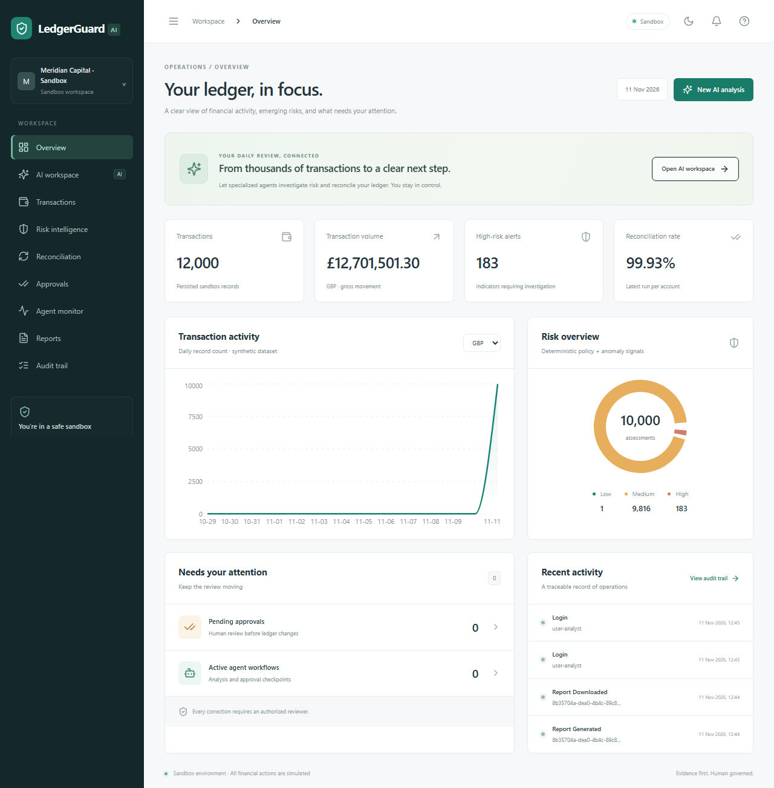
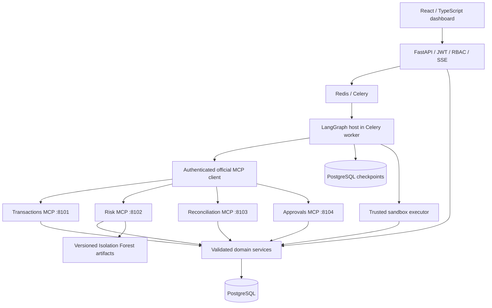
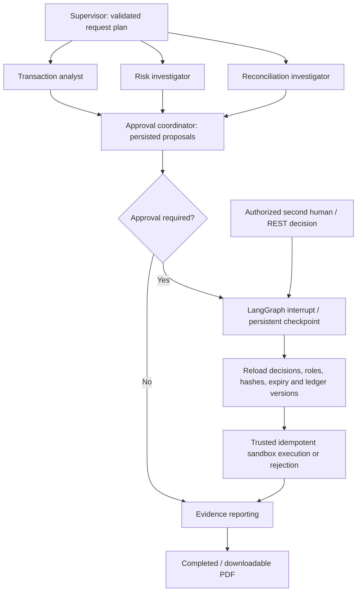

# LedgerGuard AI

**Autonomous financial operations. Deterministic calculations. Human-governed corrections.**

LedgerGuard analyses synthetic transactions, produces explainable risk indicators, reconciles a sandbox ledger against bank statements, and prepares evidence-backed corrections. Four independently deployed MCP servers provide tools to a persistent LangGraph workflow. An authorized second user must approve before a duplicate ledger entry can be voided.

This repository is a runnable portfolio platform, not a banking integration. It never connects to a live bank or transfers funds. See [implementation status](IMPLEMENTATION_STATUS.md) for executed checks and verification limits, and [demo evidence](evaluation/results/demo.json) for measured results.



[View all result screenshots](screenshots/README.md).

## Start the complete application

Prerequisite: Docker Desktop or Docker Engine with Compose v2, about 4 GB available RAM, and access to package registries for the first build.

```sh
docker compose up --build
```

Open **http://localhost:3000**. API documentation: **http://localhost:8088/docs**. Startup runs Alembic, seeds **10,000 daily transactions plus 2,000 separate historical training records**, trains a real Isolation Forest, initializes PostgreSQL checkpoints, and starts the API, frontend, four MCP servers, Celery worker, scheduler, PostgreSQL, and Redis. MCP ports are not published.

The development defaults work without an `.env` file or LLM key. To configure settings, copy `.env.example` to `.env`. Compose overrides database, Redis and MCP URLs with internal service names. Host development uses the loopback URLs in `.env.example`. Database and Redis ports are 15432 and 16379 to avoid common local conflicts.

### Development-only credentials

| Email | Role | Purpose |
|---|---|---|
| analyst@ledgerguard.demo | Financial analyst | Start reviews and investigate evidence |
| approver@ledgerguard.demo | Approver | Independently approve/reject proposals |
| checker@ledgerguard.demo | Second approver | Two-person approval policy |
| admin@ledgerguard.demo | Admin | Version risk/approval policies and train models |
| auditor@ledgerguard.demo | Auditor | Read-only governance review |

Password for these development accounts: **`SandboxDemo!2026`**. Change these credentials before sharing any demonstration. Production startup rejects demo mode and development secrets; production never seeds these accounts. Public registration always creates a separate tenant with an analyst role.

## What the platform does

- Search, filter, paginate, inspect, import and export exact signed financial records.
- Sum amounts with Python `Decimal`, partitioned by currency; calculate balances from active ledger entries.
- Combine seven deterministic risk rules with a versioned Isolation Forest anomaly signal.
- Reconcile exact references, currencies, signed amounts, settlement dates and explicitly grouped settlements.
- Preserve ambiguous candidates, partial payments, mismatches, missing records, refunds and fees as evidence.
- Run parallel transaction, risk and reconciliation branches through real MCP connections.
- Interrupt the graph at human review; resume from a durable checkpoint after authenticated decisions.
- Enforce maker-checker separation, optional two-person review, expiry, revision checks and replay protection.
- Revalidate source evidence and current policies, then void an approved sandbox duplicate exactly once.
- Stream persisted execution events, generate auditable PDF reports, and expose protected operational metrics.

## Architecture



The orchestrator is deployed inside the worker rather than as an additional service. Agent nodes use MCP for all financial retrieval and tool actions. The graph host uses the database for run/event persistence, reporting, and the explicitly trusted post-approval executor. There is no approval or execution MCP tool.

| Boundary | Implementation |
|---|---|
| Backend | Python 3.12+, FastAPI, Pydantic v2, SQLAlchemy async, Alembic |
| Durable processing | PostgreSQL, Redis, Celery, official LangGraph PostgreSQL saver |
| AI / tools | LangChain structured outputs, LangGraph StateGraph, official MCP Python SDK Streamable HTTP |
| Analytics | NumPy, pandas dependency, scikit-learn Isolation Forest, Decimal domain calculations |
| Frontend | React, TypeScript, Vite, Tailwind, shadcn-style Radix Button, TanStack Query, React Router, Recharts, React Hook Form, Zod |
| Engineering | pytest, Ruff, mypy, Vitest, Playwright, Docker, GitHub Actions, Prometheus metrics, optional LangSmith |

Versions are resolved in `uv.lock` and `apps/frontend/package-lock.json`. API usage was checked against official [MCP SDK](https://github.com/modelcontextprotocol/python-sdk), [LangGraph persistence](https://docs.langchain.com/oss/python/langgraph/persistence), [interrupt/resume](https://docs.langchain.com/oss/python/langgraph/interrupts), and [LangChain structured model integration](https://docs.langchain.com/oss/python/integrations/chat/openai) documentation and verified against the installed versions.

## MCP servers

| Independent service | Advertised tools |
|---|---|
| `ledgerguard-transactions` | `get_transactions`, `get_transaction_details`, `get_account_transaction_summary`, `detect_duplicate_transactions`, `analyse_transaction_patterns`, `search_transactions`, `list_accounts` |
| `ledgerguard-risk` | `assess_transaction_risk`, `detect_anomalous_transactions`, `analyse_account_risk`, `get_risk_alerts`, `explain_risk_assessment`, `create_risk_alert` |
| `ledgerguard-reconciliation` | `start_reconciliation`, `get_reconciliation_status`, `find_unmatched_transactions`, `detect_reconciliation_discrepancies`, `suggest_reconciliation_actions`, `get_reconciliation_report` |
| `ledgerguard-approvals` | `create_approval_request`, `get_approval_status`, `list_pending_approvals`, `get_approval_details`, `cancel_approval_request` |

Every invocation initializes an actual protocol session, discovers advertised JSON schemas, validates inputs, calls the tool, and validates structured output. Service tokens are distinct per server. A short-lived, audience-bound signed delegation names the database-verified user and tenant; caller-supplied tenant IDs are never authorization. See [MCP architecture](docs/mcp-architecture.md).

## Agents and approval workflow



The offline planner supports the examples below and makes no LLM calls. `LLM_PROVIDER=openai`, `OPENAI_API_KEY`, and `LLM_MODEL` enable structured supervisor planning and separate specialist explanations. Financial scores, matching, authorization, execution and report facts remain deterministic. Reporting assembles verified facts without an unnecessary LLM call. Specialist narratives validate cited evidence IDs; live model quality remains an evaluation responsibility.

## Reproduce the thirteen-step demonstration

Once Compose reports healthy services:

```sh
python -m pip install httpx
python scripts/demo.py --restart-worker
```

The script authenticates two users, verifies actual MCP discovery, starts the daily 10,000-transaction review, waits for the approval interrupt, restarts the worker, rejects the analyst's unauthorized approval, accepts the second user's decision, rejects decision replay, checks one execution, downloads a real PDF, and verifies the download audit record. It writes measured evidence and the PDF under `evaluation/results/`.

**The correction is intentionally permanent within that sandbox.** A subsequent review sees the duplicate already voided. To reproduce the initial approval scenario again, explicitly reset the development dataset:

```sh
docker compose stop worker beat
docker compose run --rm --no-deps api python -m ledgerguard.cli reset --confirm-sandbox-reset
docker compose run --rm --no-deps api python -m ledgerguard.cli bootstrap
docker compose start worker beat
```

Reset clears application records and checkpoints in this project's database, including demo audit history. It is disabled in production. It preserves migrations and Docker volumes. Do not use it on a dataset you want to retain.

Manual walkthrough and screenshots: [demo guide](docs/demo.md).

## Example requests

- “Find transactions above £10,000 made in the last 24 hours.”
- “Investigate unusual transaction activity for account ACC-1042.”
- “Reconcile yesterday's transactions and identify outstanding items.”
- “Explain why transaction TXN-000001 has a high-risk score.”
- “Show pending reconciliation adjustments awaiting approval.”
- “Generate a risk report for the last seven days.”
- “Compare transaction anomalies across the last three months.”
- “Prepare corrections for duplicate ledger entries but do not apply them without approval.”

Dates are UTC for dataset generation and financial queries; the browser displays timestamps in the viewer's locale. The deterministic offline planner intentionally supports a bounded vocabulary. Empty date ranges return actual empty findings.

```sh
curl -X POST http://localhost:8088/api/v1/auth/login \
  -H 'Content-Type: application/json' \
  -d '{"email":"analyst@ledgerguard.demo","password":"SandboxDemo!2026"}'

# Use the returned access token:
curl -X POST http://localhost:8088/api/v1/agents/run \
  -H 'Authorization: Bearer ACCESS_TOKEN' -H 'Content-Type: application/json' \
  -d '{"request":"Analyse today transactions, identify high-risk activity and reconcile payments."}'
```

Interactive OpenAPI lists request schemas and all routes. [API guide](docs/api.md) describes jobs, SSE, imports and approval revisions.

## Dataset and model commands

```sh
docker compose exec api python -m ledgerguard.cli validate
docker compose exec api python -m ledgerguard.cli train
# Seed only an empty development database:
docker compose exec api python -m ledgerguard.cli seed --count 10000 --seed 42 --anomaly-rate 0.02
```

The seed includes four accounts in GBP/USD/EUR, sixty counterparties, independent historical training data, high-value events, duplicate source records with one bank settlement, missing records, amount/currency differences, delayed/partial/aggregate settlements, refunds, reversals, fees, unusual hours and beneficiary patterns. Labels are ground truth for evaluation; they never enter inference features. CSV imports accept UTF-8 synthetic transaction/statement data, enforce schemas and size limits, and run as durable background jobs. [Dataset and schema details](docs/database.md).

## Risk scoring and reconciliation

Risk scores sum configured rule weights, capped at 100: high value 35, velocity 20, unusual hour 15, new beneficiary 10, duplicate 20, historical deviation 20, volume increase 10, Isolation Forest signal 15. Categories are LOW <30, MEDIUM 30–59, HIGH ≥60. This is an explainable sandbox policy, not a calibrated fraud probability or AML determination. [Risk methodology](docs/risk-engine.md).

Reconciliation preserves signed amounts and uses trusted references first. Explicit bank group references allow exact-sum splits or aggregation; ambiguous groups remain exceptions. Unique non-reference candidates are suggestions requiring investigation. Duplicate proposals retain the original transaction and bank evidence. Corrections only deactivate the duplicate ledger entry after approval, preserving immutable source data. [Matching algorithm](docs/reconciliation.md).

## Local development and tests

```sh
python -m pip install uv
uv sync --frozen
uv run ruff check src tests scripts alembic evaluation
uv run mypy src/ledgerguard
uv run pytest -q

cd apps/frontend
npm ci
npm test
npm run build
npx playwright install chromium
npm run test:e2e
```

Python tests create an isolated temporary SQLite database and launch four real MCP subprocesses. No LLM key is needed. PostgreSQL concurrency and immutable-record verification runs against the Compose database:

```sh
docker compose exec api python scripts/verify_postgres.py
python scripts/load_test.py --requests 100 --concurrency 5
```

For host-only development, set `PYTHONPATH=src`, `TASK_MODE=inline`, and a SQLite `DATABASE_URL`; run Alembic and `python -m ledgerguard.cli bootstrap`, start the four MCP processes on ports 8101–8104, and run `uvicorn ledgerguard.api:app --port 8088`. `npm run dev` proxies to that API. Inline tasks are for development; Compose uses Celery. On Windows ARM64, use x64 Python if ML wheels are unavailable. Docker is the recommended portable runtime for psycopg async checkpointing.

## Repository map

```text
src/ledgerguard/
  api.py                 Versioned REST API, auth, SSE, jobs
  config.py, db.py        Validated runtime configuration and async transactions
  models.py, schemas.py   Persistent entities and Pydantic validation
  security.py            JWT sessions, delegation, RBAC and audit
  transactions.py        Queries, exact balances and analytics
  seed.py, imports.py     Reproducible data and validated CSV imports
  risk.py                Separate model training and risk inference
  reconciliation.py      Deterministic matching and proposals
  approvals.py           Human decisions and atomic sandbox execution
  mcp_server.py          Independent official SDK server factory / entrypoints
  mcp_client.py          Discovery, schemas, authenticated transport and budgets
  orchestrator.py        Typed parallel graph, checkpoints, interrupts and resume
  workers.py             Celery jobs, scheduler and recovery
  reports.py             Evidence reports and PDFs
  cache.py               Tenant-specific Redis dashboard caching
  observability.py       Structured logs and metrics
apps/frontend/           React application, UI components and browser tests
alembic/                 Frozen schema migrations and PostgreSQL integrity guards
tests/                   Financial, protocol, API, graph and security tests
scripts/                 End-to-end demo, PostgreSQL checks and load benchmark
evaluation/              Labelled routing cases, evaluation runner and measured evidence
infrastructure/          AWS deployment guidance and monitoring examples
docs/                    Architecture, security, workflow and operational guides
.github/workflows/       CI tests, builds and complete Compose demonstration
```

## Security, observability and deployment

Tenant-scoped reads and writes, Argon2 passwords, access JWTs with revocable sessions, refresh rotation, role checks, signed MCP delegation, source immutability, decision history, row locks and idempotency constraints protect the sandbox. Metadata is untrusted; agents cannot select arbitrary tools, execute SQL, access files, run shell commands, approve requests or post financial corrections through MCP. [Security details and limits](docs/security.md).

Structured request and tool logs include correlation IDs and timings without tokens. Protected `/metrics` exposes API, MCP, graph and configured LLM usage metrics. `LANGSMITH_TRACING=true` plus credentials enables model traces; absent credentials leave tracing disabled. Cost estimates use your configured per-million-token rates; no default price claim is made. [Observability and evaluation](docs/observability.md).

GitHub Actions runs Python checks/tests, real MCP integration, frontend checks, image builds, the restart/resume demo, PostgreSQL concurrency tests and Playwright. AWS guidance covers private ECS tasks, RDS, ElastiCache, Secrets Manager, CloudWatch, ALB, ECR and optional S3; **no cloud infrastructure is automatically deployed**. [Deployment guide](docs/deployment.md).

## Recorded verification

Local checks passed: **59 Python tests**, **3 Vitest tests**, **3 Chromium flows**, Ruff, mypy, TypeScript/Vite, Docker startup and PostgreSQL concurrency/immutability checks. npm audit reported zero vulnerabilities. The final real-MCP review analysed 10,000 daily records with ML enabled, paused for an independent reviewer, resumed after worker restart, applied one approved sandbox correction and produced an audited PDF. See [measured evidence](evaluation/results/demo.json) and [verification details](IMPLEMENTATION_STATUS.md).

Optional monitoring: `docker compose --profile monitoring up -d prometheus`, then open http://localhost:9090. Its API scrape uses a separate monitoring token. Production requires a unique `METRICS_TOKEN` and the other independent secrets.

## Known limitations

- This is a sandbox implementation, not a regulated banking or AML product. No FX conversion, accounting close, payment rails, live customer data or financial compliance certification is provided.
- Exact matching and explicit grouped settlements are automated; descriptive/non-reference candidates always remain manual suggestions. Mixed-tenant composite foreign keys and PostgreSQL RLS are additional production hardening opportunities; application services enforce tenant checks today.
- Daily 10,000-record verification is recorded in the evidence file. Larger-volume capacity is unmeasured. Statistical feature engineering intentionally uses floats; monetary arithmetic does not.
- Live LLM/provider quality, token costs and remote LangSmith ingestion need external credentials and are unverified unless explicitly recorded. Offline tests do not establish live model robustness.
- The bundled image includes verification dependencies. A production release should use a separately hardened runtime image, dedicated migration identity, managed secrets, TLS, durable artifact/report storage and tested backups.
- SQLite is a portable test backend; PostgreSQL is required for the documented multi-process locking and immutable-trigger guarantees.
- Public registration isolates a new analyst tenant. Membership provisioning/enterprise SSO and administrative account onboarding are outside the demonstration flow; use seeded users for the complete review scenario.

Precise verified and pending items are maintained in [IMPLEMENTATION_STATUS.md](IMPLEMENTATION_STATUS.md). Future work includes calibrated models, richer analyst review UX, SSO, RLS, accounting-period controls and larger-scale benchmarks.
