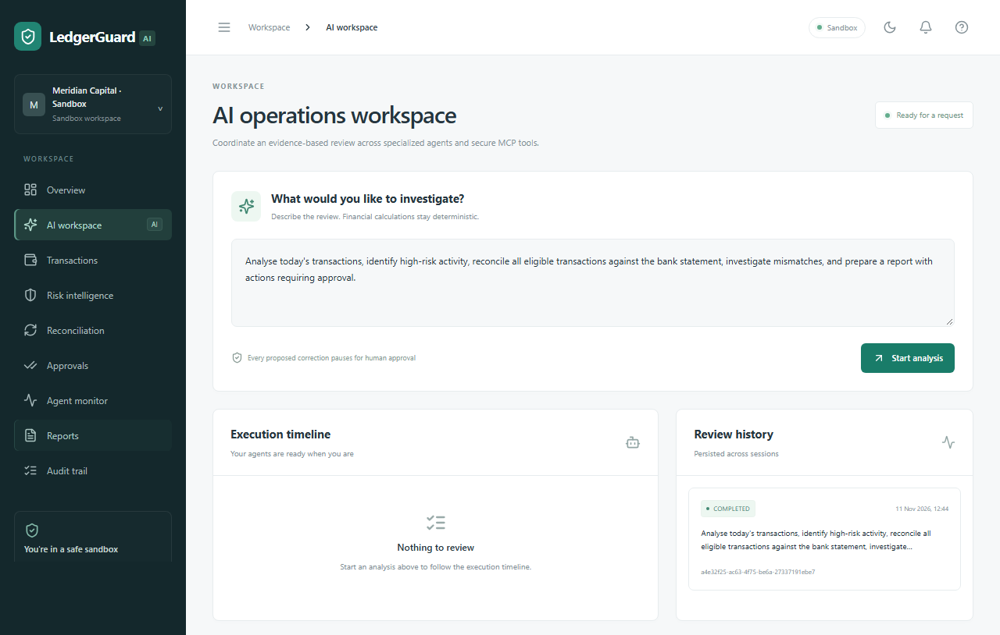
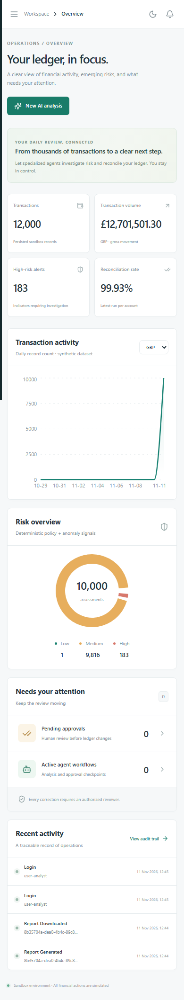

# Daily financial operations review: thirteen steps

Use a fresh development seed for the full duplicate-approval scenario. The automated equivalent is `python scripts/demo.py --restart-worker`.

1. **Generate data:** `docker compose up --build` migrates the database and creates 10,000 daily synthetic records, 2,000 historical training rows, ledger entries, statements, counterparties and labelled exceptions. Bootstrap separately trains the Isolation Forest. `docker compose exec api python -m ledgerguard.cli validate` prints balances and record counts.
2. **Log in:** open `http://localhost:3000` as `analyst@ledgerguard.demo`, password `SandboxDemo!2026`.
3. **Request analysis:** open AI workspace and submit the default daily review prompt. The request goes to `/api/v1/agents/run`; the browser shows its persistent thread ID.
4. **Inspect the plan:** the supervisor resolves the requested period and account scope, discovers account/statement IDs through MCP and emits PLAN_CREATED.
5. **Inspect tool calls:** Agent monitor lists the actual MCP servers, tools, durations and statuses. The client initializes/discovers before invocation. No tool calls are simulated.
6. **Inspect risk:** Risk intelligence lists scores, triggered rules, evidence and the model version. HIGH means an investigation priority. The demo script requires `ml_available=true`.
7. **Inspect reconciliation:** each account/statement produces a persisted summary, accepted matches and source-backed exception classifications. Splits and aggregation require an explicit group; ambiguous records remain open.
8. **Inspect the proposal:** the duplicate exception creates `VOID_DUPLICATE` with original, duplicate, bank, ledger-version and job/exception evidence. The ledger is unchanged.
9. **Observe the pause:** the approval coordinator requests review through Approval MCP; LangGraph saves an interrupt. The run becomes WAITING_APPROVAL. The script restarts the Celery worker at this point to prove reload from PostgreSQL.
10. **Decide independently:** sign out and sign in as `approver@ledgerguard.demo`. Open Approval centre, inspect the proposal, choose Approve, enter a reason and confirm. The analyst's attempt is denied. Use Reject or Request investigation for the alternative paths. High-value policies may require the `checker@ledgerguard.demo` user as a second reviewer.
11. **Resume:** the API commits the human decision and dispatches resume. The trusted executor checks persisted votes, identity, digest, expiry, current thresholds and unchanged ledger/bank evidence. It deactivates the duplicate entry once, leaving immutable transactions and the original active.
12. **Review the report:** the run completes. Reports contain transaction count, currency totals, risk methodology/results, reconciliation counts, exceptions, proposals, decisions, executed adjustments, tool history and limitations.
13. **Download:** choose PDF. The PDF is generated from persisted report facts; audit history records REPORT_DOWNLOADED. The automated script saves PDF bytes and measured JSON under `evaluation/results/`.

The demo script also verifies approval replay returns 409 and that exactly one execution appears. PostgreSQL concurrency verification separately submits simultaneous decisions and executions. Before running the browser suite on a fresh database, run `docker compose exec api python scripts/prepare_browser_case.py`. A separate tenant supports an actual two-user UI approval without changing the 10,000-record demo tenant. Browser tests cover login, filters, risk charts, detail dialogs, PDF download, starting a review, refresh persistence, independent approval and mobile layout.

To replay from the initial state, follow the explicit sandbox reset commands in the README. A normal subsequent review correctly sees the duplicate already voided and does not invent a new required correction.
