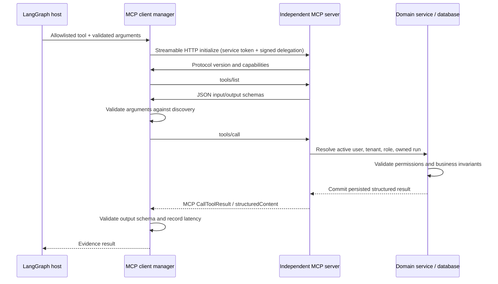

# MCP communication and authorization

Each service uses the official SDK's `FastMCP(..., stateless_http=True, json_response=True)` and `streamable_http_app()`. Typed `dict[str, Any]` outputs advertise an object schema; inputs are generated from Python annotations and validated through Pydantic domain schemas. `ClientSession.initialize()`, `list_tools()` and `call_tool()` operate over `streamable_http_client`, not imitation REST tool routes.

There are two independent authentication factors: a different high-entropy service bearer token per server, and an HMAC-signed short-lived context JWT. Context includes `sub`, tenant, role, optional run, issuer, expiry, audience `mcp:<server>` and a unique token ID. The server rechecks user activation, tenant, current role and run ownership. A service bearer token alone is insufficient. A token for one server cannot delegate to another.

This is a **private service-to-service authentication design**, not an implementation of the public MCP OAuth authorization-server discovery flow. Direct untrusted/public MCP access is not supported. If exposing the servers outside the trusted network, implement the MCP authorization specification with a proper identity provider and resource audience validation. Use TLS/mTLS between hosts.

DNS-rebinding protection validates Host/Origin against the configured server, localhost and test addresses. The host restricts tool names independently of discovery. No tool can issue SQL, shell commands, read arbitrary files, approve a proposal, or execute a correction. Untrusted descriptions are data, never routing or authorization instructions. Every completed/failed call records service, tool, elapsed time, tenant and run.

The client currently opens a fresh short-lived protocol connection per call; this avoids cross-task context-manager ownership and tenant-session reuse. Pooling may improve latency after benchmarking, but cannot weaken principal isolation. Tool counts are bounded across checkpoint resumes; attempts of state-changing operations are not retried automatically by the client.

The health route checks database connectivity; authenticated `/api/v1/mcp/health` additionally performs actual initialization/discovery. Protocol tests spawn four independent processes and test all tool inventories, structured invocation, invalid arguments and denied requests.

References: [official Python SDK](https://github.com/modelcontextprotocol/python-sdk), [MCP authorization specification](https://modelcontextprotocol.io/specification/latest/basic/authorization).
