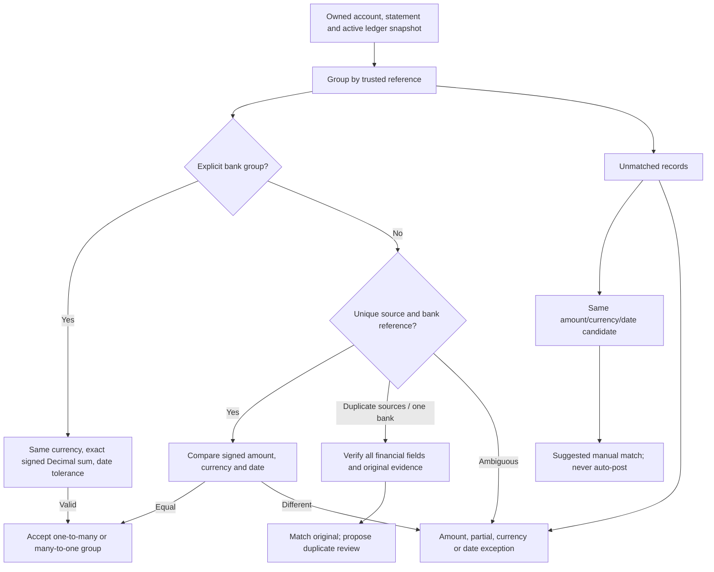

# Deterministic reconciliation

The statement belongs to the authenticated tenant and specified account. Ledger records respect the requested booking period; bank records include the full selected statement so delayed settlements are visible. Matching tolerance defaults to three calendar days. Signed amounts preserve refunds and reversals; different currencies cannot match. Bank fees remain an explicit exception.

Exact trusted reference + amount + currency + date is the strongest match. An unambiguous same-reference settlement within tolerance is accepted with an explanation. Explicit `group_reference` on bank rows permits exact-sum split and aggregate scenarios. Implicit sums, descriptive similarity and non-reference candidates remain suggestions; there is no weaker automatic identifier in the current data schema. This conservative choice avoids accepting ambiguous fuzzy matches.

Each record can be removed from the unmatched map only once. Results include match groups, matched source record counts, unmatched record counts and categorized exceptions. Counts are records, not monetary totals. A hash of the financial snapshot and tolerance is the job idempotency key; PostgreSQL advisory locking prevents concurrent duplicate jobs.

Duplicate proof requires identical account, reference, signed amount, currency, booking date and beneficiary; the single bank settlement must agree. The original is retained deterministically by booking time/ID. A proposal stores target ledger ID/version, original ID, bank ID, exception/job IDs, amount, currency and action version under a canonical SHA-256 digest.

The only implemented corrective action is `VOID_DUPLICATE`. It deactivates a simulated ledger entry after human review. Missing rows, partial payments, fees, ambiguous references, date and currency mismatches remain explicit investigation exceptions. No automatic missing-entry posting or fuzzy financial correction occurs.

Execution revalidates the current original and duplicate, active original ledger, bank ownership, single settlement, proposal digest, ledger version, independent active approvers, unexpired authorization and current stricter thresholds. A unique action execution row and compare-and-swap make repeated invocation return the original execution instead of changing the ledger twice.
