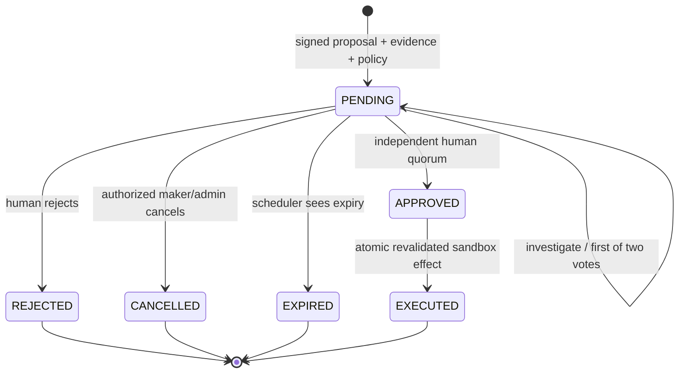

# Security model and boundaries

All financial records and actions are synthetic. There are no live banking credentials, payment rails or transfer tools. The only correction deactivates an approved duplicate sandbox ledger entry.

## Identity and tenant scope

Argon2 protects passwords. Short-lived HS256 JWTs reference revocable database sessions; refresh tokens are random, stored as SHA-256 hashes, rotated atomically, and cannot be replayed. Logout revokes the session, including existing access tokens. Every request reloads current user activation and role. Registration rejects extra role/tenant fields and creates an independent analyst tenant.

All domain queries enforce tenant scope using the authenticated/delegated principal. Lookup failures for another tenant return not found. MCP JWT audiences and current-user resolution prevent forged tenant context. Shared ORM models use foreign keys and tenant-scoped indexes. Application checks are the isolation boundary today; PostgreSQL RLS/composite tenant foreign keys would provide additional defense in depth.

Production configuration rejects demo mode, inline workers, short secrets and development secret defaults. Supply independent random JWT, delegation and four MCP service keys via a secret manager. Never publish internal MCP services, Redis or PostgreSQL. Local Compose binds exposed data services and API/UI to loopback only.

## Approval state machine

Execution errors fail the run and preserve the approved request for explicit investigation/retry. Failure is recorded on the run rather than overwriting the human's decision with an execution status. Decision history remains independent of execution results.

The maker cannot decide their proposal, even after a role change to admin. Decisions require an approver/admin, expected approval revision, unchanged canonical proposal digest, unexpired request, no prior vote from that actor and database row locks. Two-person approval uses two distinct eligible humans for actions at/above the configured absolute threshold. Investigation records an audit event and leaves the request pending with a new revision, without casting a vote.

Execution independently reloads all recorded votes, current roles/activation, maker identity, digest, expiry, source/bank ownership and values, active original and target ledger version. A stricter current policy applies immediately. An `approved: true` value, LLM text, MCP result narrative or resume payload cannot authorize an action. The executor is worker-internal and has no public route or MCP capability.

## Agent containment

Only fixed role-specific tool names may be called. The supervisor produces a constrained Pydantic plan, not executable SQL or arbitrary tool names. Transaction descriptions and uploaded files are untrusted. Descriptions are excluded from ML features and optional LLM risk evidence; where descriptive similarity is computed, it only proposes manual candidates. Model narratives validate cited evidence IDs and never control monetary operations. This reduces injection reach but does not prove all live-model attacks fail; live adversarial model evaluation requires credentials.

Calls have timeouts, bounded read retries, persistent tool-call budgets and immutable financial effects. Authentication failures and schema errors cannot become financial writes. File uploads have schema/encoding/size limits; pickle upload and arbitrary file access are absent. CSV text exports escape formula prefixes.

## Audit and browser

PostgreSQL triggers reject UPDATE/DELETE of source transactions, bank rows, decisions, executions and audit logs. Database administrators can change schema/triggers; this is not tamper-proof retention. External immutable retention and a least-privilege runtime database identity are production extensions. Explicit development reset truncates demo history by design and is disabled in production.

The browser keeps tokens in sessionStorage, never URLs, and uses authenticated fetch for SSE/PDF. nginx supplies CSP, frame restrictions and nosniff headers; CORS uses an explicit allowlist. SessionStorage still exposes tokens to an XSS bug; a hardened production identity design should use an appropriate secure session/SSO architecture. TLS is expected at the hosted load balancer. Redis rate limits fail closed in production; dashboard caching is tenant-specific and expires after ten seconds.

Security checks include role and tenant isolation, maker-checker, stale/expired/tampered proposals, two-person quorum, role revocation, replay, idempotent execution, MCP authentication and an actual PostgreSQL concurrency verification script.
