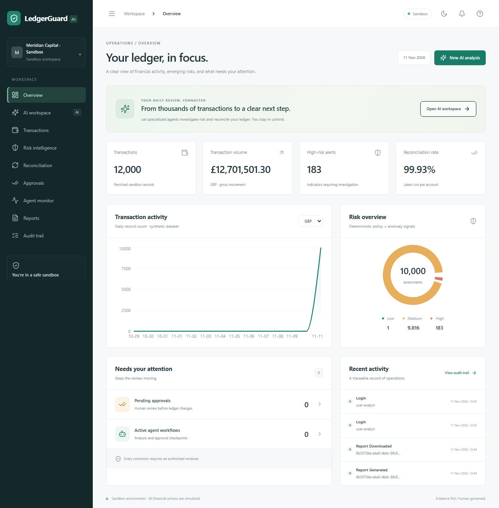
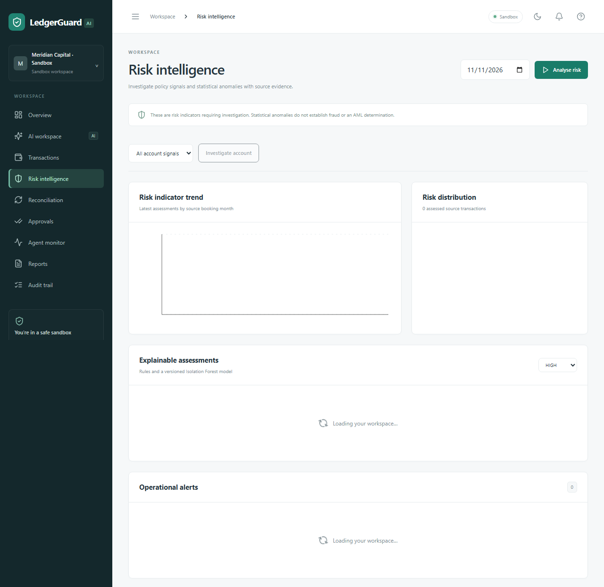
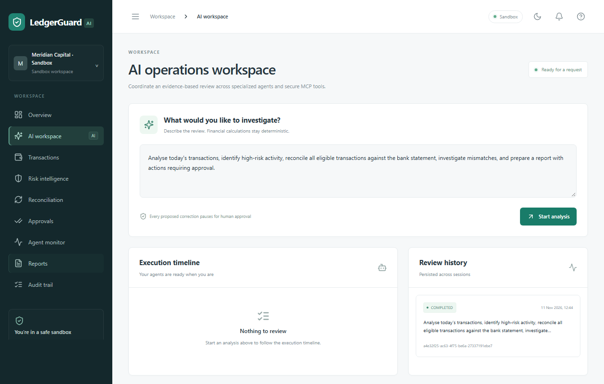
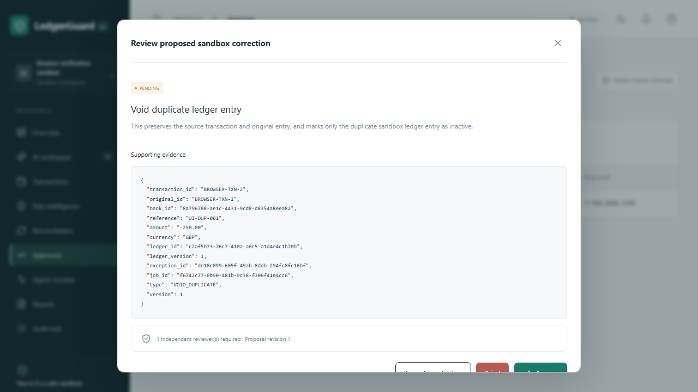
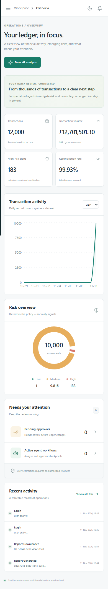

# LedgerGuard AI result screenshots

These screenshots were captured from the running application during the verified Playwright browser flows. They show persisted synthetic sandbox data and the human approval interface.

| Screenshot | Result shown |
|---|---|
| [Overview](overview.png) | Transaction totals, financial volume, risk distribution, reconciliation rate and recent activity |
| [Risk intelligence](risk.png) | Risk indicators, trend and distribution charts, and assessment evidence |
| [AI workspace](operations.png) | Analysis request interface and persisted workflow history |
| [Approval review](approval-review.png) | An independent reviewer inspecting a pending duplicate correction and its supporting evidence |
| [Mobile overview](mobile.png) | Responsive dashboard at a 390-pixel viewport width |

## Overview



## Risk intelligence



## AI operations workspace



## Human approval review



## Mobile overview



## Refresh the screenshots

The browser tests in [workspace.spec.ts](../apps/frontend/e2e/workspace.spec.ts) write captures directly into this folder. Follow the [demo setup and reset instructions](../docs/demo.md) to prepare the initial approval scenario, then run:

```sh
docker compose up -d
docker compose exec api python scripts/prepare_browser_case.py
cd apps/frontend
npm ci
npx playwright install chromium
npm run test:e2e
```

The isolated browser approval scenario is consumed when approved; use the documented development reset before repeating that scenario. Machine-readable workflow results and the generated PDF remain in [evaluation/results](../evaluation/results/).
